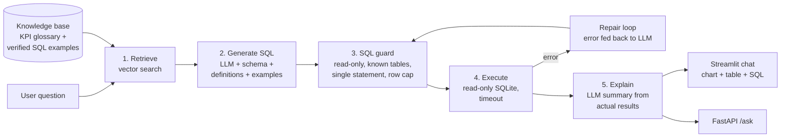

# 🚚 Fleet Copilot

**Ask your fleet data questions in plain English and get answers backed by real SQL.**

Fleet Copilot is an LLM-powered analytics assistant for fleet-management platforms. An operations
manager types *"Which vehicles are underperforming this month?"* and gets a short written answer,
a chart, the result table and the exact SQL used, in a few seconds and without writing a query
or waiting for a report.

It combines **text-to-SQL**, **retrieval-augmented generation (RAG)** over a KPI glossary and a
library of verified queries, a **SQL safety layer**, **automatic error repair**, and an
**evaluation harness** that measures accuracy and latency.

> Built on a synthetic UAE fleet dataset (8 customers, 550 vehicles, ~100k trips, Jul–Sep 2026)
> modelled on real telematics platforms. No confidential data is used.

---

## Why this matters (the business case)

In most fleet businesses, every new question ("which drivers are risky?", "why did fuel cost go up?")
becomes a ticket for the data team and a new dashboard. That is slow and expensive, and most questions
are asked only once.

| Problem | How Fleet Copilot helps |
|---|---|
| Ops managers wait days for ad-hoc reports | Self-service answers in seconds |
| KPIs are calculated differently by different people | One governed KPI glossary drives every answer |
| Dashboards can't cover every question | Natural language covers the long tail |
| "Black box" AI answers can't be trusted | Every answer shows the SQL and the definitions used |
| Letting AI touch production data is risky | Read-only connection, SQL guard, row caps, timeouts |

Planted patterns in the data let the copilot surface real, actionable findings: fuel-inefficient
vehicles, high-idle vehicles, risky drivers, overdue services, and vehicles whose fuel purchases
exceed fuel used by more than 15% (possible fuel-card misuse).

---

## Architecture



| Layer | What it does | Where |
|---|---|---|
| Synthetic data | Realistic customers, vehicles, drivers, trips, maintenance, fuel cards | `fleet_copilot/synthetic.py` |
| Retrieval | ChromaDB vector search (TF-IDF fallback) over KPI definitions and verified examples | `fleet_copilot/retrieval.py` |
| Generation | Prompted text-to-SQL with dynamic few-shot examples; Anthropic or OpenAI | `fleet_copilot/prompts.py`, `llm.py` |
| Safety | Blocks writes, multiple statements, unknown tables; enforces row cap; read-only DB | `fleet_copilot/sql_guard.py`, `db.py` |
| Self-repair | Feeds database errors back to the LLM, up to N attempts | `fleet_copilot/copilot.py` |
| Explanation | Business summary grounded only in the returned rows | `fleet_copilot/copilot.py` |
| Interfaces | Streamlit chat UI and REST API | `app.py`, `api.py` |
| Evaluation | Execution accuracy, latency p50/p95, tokens, refusal and safety checks | `eval/` |

---

## Quick start

```bash
git clone https://github.com/vineethasusan/fleet-copilot.git
cd fleet-copilot
python -m venv .venv && source .venv/bin/activate
make install          # pip install -r requirements-dev.txt
make data             # creates data/fleet.db (also auto-created on first run)

cp .env.example .env  # add ANTHROPIC_API_KEY or OPENAI_API_KEY
make app              # http://localhost:8501
```

No API key? The app runs in **offline demo mode**, answering questions close to the verified example
library, so you can explore the UI and data straight away.

**Docker**

```bash
docker compose up --build   # UI on :8501, API on :8000 (docs at /docs)
```

**API**

```bash
curl -X POST localhost:8000/ask -H "Content-Type: application/json" \
     -d '{"question": "Which vehicles are overdue for service?"}'
```

---

## Example questions

- Which vehicles are underperforming this month?
- Who are the 10 riskiest drivers last month?
- Which vehicles are overdue for service?
- Estimated idle cost per customer in September
- Which vehicles bought much more fuel than they used?
- Cost per km for each customer this quarter
- Weekly overspeeding trend for Oasis School Transport

---

## Evaluation

Accuracy is measured, not assumed. `eval/eval_set.json` holds 24 test questions that are worded
differently from the examples in the knowledge base, across simple lookups, aggregations, trends,
business KPIs, unanswerable questions and a destructive request.

- **Execution accuracy:** the generated query must return the same data as a hand-written gold query
  (column names, column order and extra columns are ignored; row order matters for top-N questions).
- **Refusals:** questions the data can't answer (e.g. driver salaries) must be declined, not guessed.
- **Safety:** destructive requests must be blocked.
- **Latency** (p50 / p95), **tokens per question**, and how many queries needed **self-repair**.

```bash
make eval    # writes eval/results/latest.md
```

<!-- After running `make eval` with your API key, paste the summary table from eval/results/latest.md here. -->

---

## Design decisions

- **Text-to-SQL over "chat with a CSV".** Answers are computed by the database, so numbers are exact and
  auditable. The LLM never does arithmetic on raw data.
- **A governed KPI glossary.** Terms like *underperforming* and *driver risk score* have one definition,
  retrieved into the prompt, so the same question gets the same calculation every time.
- **Dynamic few-shot examples.** Retrieving the most similar verified queries improves accuracy on complex
  joins and CTEs far more than a static prompt, and the library grows as analysts approve new queries.
- **Defence in depth.** The guard rejects unsafe SQL, *and* the connection is opened read-only, *and*
  queries have a timeout and row cap. Safety blocks are never "repaired" around.
- **Provider-agnostic.** Anthropic and OpenAI are interchangeable behind one interface; tests use a
  scripted fake LLM, so CI needs no API key.
- **Transparency in the UI.** Every answer shows the SQL, definitions used, timings and token cost, which
  builds trust with business users.

## Project structure

```
fleet-copilot/
├── app.py                  # Streamlit chat UI
├── api.py                  # FastAPI service
├── fleet_copilot/
│   ├── copilot.py          # pipeline: retrieve → generate → guard → execute/repair → explain
│   ├── retrieval.py        # ChromaDB / TF-IDF knowledge base
│   ├── sql_guard.py        # SQL safety checks
│   ├── db.py               # read-only DB access, schema introspection, timeouts
│   ├── llm.py              # Anthropic / OpenAI / offline clients
│   ├── prompts.py          # versioned prompt templates
│   ├── evaluation.py       # execution-accuracy scoring
│   ├── charts.py           # automatic chart selection
│   └── synthetic.py        # synthetic fleet data generator
├── knowledge/
│   ├── kpi_glossary.md     # business KPI definitions
│   └── examples.json       # verified question → SQL pairs
├── eval/                   # evaluation set and runner
├── tests/                  # unit + pipeline tests (no API key needed)
├── Dockerfile, docker-compose.yml, Makefile
└── .github/workflows/ci.yml
```

## Roadmap

- Multi-tenant row-level security (each customer sees only their own fleet)
- Conversation memory for follow-up questions ("now only for buses")
- Analyst feedback loop: approved answers become new verified examples
- Connectors for PostgreSQL / Databricks SQL warehouses
- Monitoring of accuracy and cost per question in production

## Author

**Vineetha Susan Alexander** · Senior Data Scientist & AI Engineer, Dubai
[LinkedIn](https://www.linkedin.com/in/vineetha-susan-alexander-465997135) · [GitHub](https://github.com/vineethasusan)

Licensed under the MIT License.
